<p align="center">
  <h1 align="center">HCU 桌面自动化技能</h1>
</p>

<p align="center">
  <em>点击成功 ≠ 任务完成。</em>
</p>

<p align="center">
  <a href="https://github.com/lumina03c-beep/hcu-desktop-automation/actions/workflows/validate.yml"></a>
  
  
  
  
</p>

<p align="center">
  <a href="README.md">English</a> &middot; <a href="README.zh-CN.md">简体中文</a>
</p>

---

这是面向动态 UI RPA 的 Agent Skills 决策层，覆盖 **浏览器（ego-browser）** 与 **桌面（Microsoft HCU）** 两个执行引擎。它帮助 Agent 维护唯一的任务 Workspace，按阶段选择引擎，批量执行确定性操作，验证真实结果，避免盲目重试，并在证据不足时安全停止。

仓库还包含一个基于用户确认的引导脚本，用于克隆并构建官方 HCU MCP 服务器，并配置支持 MCP 的 Agent。

## 这是什么，不是什么

**本项目不是 HCU。** 它是一套告诉 AI Agent *如何用好* HCU 的指令。

| | 本项目 | 微软 HCU |
| --- | --- | --- |
| 是什么 | Markdown 策略 + Python 安装辅助脚本 | 真正的 MCP 服务器、CLI 和原生桌面 provider |
| 用什么写的 | Markdown、Python（仅标准库） | Go、Swift、C#、TypeScript |
| 怎么安装 | `git clone` 本仓库 | 从源码构建，或通过 `scripts/hcu_setup.py` |

- 本仓库**不含任何 HCU 源码，也不含 HCU 二进制**。`scripts/hcu_setup.py` 会把 `microsoft/Hybrid-Computer-Use` 克隆到本仓库**之外**的独立目录，在那里构建。
- 浏览器任务需要单独安装的 ego-browser 技能；桌面任务需要 HCU。纯浏览器任务不依赖 HCU，纯桌面任务也不依赖 ego-browser。
- 真正的点击、截图、无障碍树出问题，请去 [微软的 issue 区](https://github.com/microsoft/Hybrid-Computer-Use/issues)，不是这里。
- "HCU" 和 "Hybrid Computer Use" 指微软的项目。本仓库是独立的第三方配套项目，与微软无隶属关系。

## 为什么需要这个技能

点击成功不等于任务完成。大多数桌面自动化失败的原因不是点丢了，而是点完之后没人检查发生了什么。这个技能把桌面自动化变成一个闭环：

```text
任务契约 → 状态归属 → 充分观察 → 通道选择
→ 风险评估后的批量操作 → 效果/差异 → 独立的结果证据
→ 恢复、改道或停止
```

核心能力：

- **任务契约** — 动手前明确目标、目标对象、约束、前置条件、风险和成功判据。
- **动态 UI 路由** — Web 优先浏览器，原生 UI 走桌面，只有真正跨双引擎才用 Hybrid。
- **任务 Workspace** — 一个用户任务对应一份权威 JSON，记录已验证步骤、交接、副作用和产物。
- **基于状态的路由** — 根据“真相存在哪里”选择通道，而不是记应用特定的操作配方。
- **风险分级执行** — R0 只读、R1 可逆变更、R2 高影响/外部可见变更。
- **证据等级** — L1 输入送达、L2 应用状态、L3 已验证的用户结果或持久化产物。
- **实时状态安全** — 会话级引用、GUI 帧租约、Windows 输入保护、条件等待。
- **恢复纪律** — 变更记录、副作用分类、两击规则、明确的停止条件。
- **泛化评估** — 开发/回归/留出集分离，以及假成功率度量。
- **多 Agent 接入** — 一个可移植技能 + 各客户端专属的 MCP 配置适配器。

## 快速开始

> **先读这段。** 技能**本体**一条命令就能装好。HCU 桌面引擎则不同：要跑起来就得编译原生代码，需要几分钟，而且机器上得先有 Go 1.22+、.NET 8 SDK（Windows）和 PowerShell 7+。下面的步骤会替你完成这些活儿，但第一次构建不是瞬间的事。

**最快的路径：技能一条命令，HCU 先做只读体检。**

```bash
npx skills add lumina03c-beep/hcu-desktop-automation -g   # 一条命令：把技能装进检测到的 Agent
python3 scripts/hcu_setup.py doctor                       # 只读：告诉你 HCU 还缺什么
```

`npx skills add` 需要 Node.js 22.20+，来自 [vercel-labs/skills](https://github.com/vercel-labs/skills)（开放的 Agent Skills 安装器）。它会检测你机器上已装的 Agent（Claude Code、OpenCode、Codex、Gemini CLI、Cursor 等），把技能放到各自对应的目录，并写入 `skills-lock.json`，之后可用 `npx skills check` 和 `npx skills update` 保持更新。不加 `-g` 时只装到当前项目；Windows 上如果系统不允许创建符号链接，请加 `--copy`。

在已安装的技能目录里（例如 `~/.config/opencode/skills/hcu-desktop-automation`）或普通 git clone 的目录里运行 `doctor`。如果 `doctor` 显示所有工具都可用，就运行 `python3 scripts/hcu_setup.py install` 并批准它打印的方案。如果缺东西，先装那个工具 —— doctor 会点名。

### 技能该放在哪

快速开始里的 `npx skills add` 会自动完成这一步。手动或离线方式 —— 不同 Agent 的技能目录不一样，把克隆下来的文件夹复制或软链到对应位置：

| Agent | 技能目录 | 备注 |
| --- | --- | --- |
| Claude Code | `~/.claude/skills/` | 个人技能；项目级放在仓库内的 `.claude/skills/` |
| OpenCode | `~/.config/opencode/skills/` | 全局；单个项目用 `.opencode/skills/` |
| Codex | `~/.codex/skills/` | 加完后重启 CLI |
| Gemini CLI | `~/.gemini/skills/` | 以你版本的文件为准 —— 这个路径各版本间变过 |
| Grok Build | `~/.grok/skills/` | 以你版本的文件为准 |
| 其他 | 你的 Agent 文档 | 要求是根目录下有 `SKILL.md` 的文件夹 |

拿不准？先跑 `python3 scripts/validate_skill.py` —— 它会确认这个文件夹是合法的技能，再去找放哪儿。

### 1. 把技能添加到你的 Agent

本仓库是标准的 [Agent Skills](https://agentskills.io/specification) 目录，任何支持该格式的 Agent 都能直接使用。

自动方式就是快速开始里的 `npx skills add` 命令；它会装到检测到的 Agent，之后可用 `npx skills check` 和 `npx skills update` 保持更新。

手动方式，适合离线场景或需要固定某个本地检出版本：

```bash
git clone https://github.com/lumina03c-beep/hcu-desktop-automation.git
```

把得到的 `hcu-desktop-automation/` 目录放到或软链到你的 Agent 的技能发现路径，然后按该 Agent 的文档启用或重启技能发现。必需入口是根目录下的 `SKILL.md`。

技能本身不含任何客户端专属配置，MCP 注册是独立的一步。

### 2. 只检查 HCU，不做任何改动

在仓库根目录：

```bash
python3 scripts/hcu_setup.py doctor
```

Windows 上没有 `python3` 时用 `python`。安装工具需要 Python 3.10+，且只用标准库。doctor 会报告操作系统、原生构建/运行时依赖、HCU 源码/构建路径和桌面要求；它不安装任何东西，也不写配置。

### 3. 构建 HCU

确认 doctor 输出并同意下载/构建之后：

```bash
python3 scripts/hcu_setup.py install --yes
```

不带 `--client` 参数时，安装器只构建 HCU 并打印通用的 stdio MCP 配置，不写任何客户端配置。

安装器会：

1. 默认克隆 `microsoft/Hybrid-Computer-Use` 的 `v1.0.0`；
2. 用官方平台构建路径构建；
3. 运行官方 MCP 冒烟测试，要求恰好暴露 `AX` 和 `GUI`；
4. 运行 `computer-use doctor`；
5. 打印通用客户端配置。

已有的源码树会被复用。`--update` 只允许对干净的树做快进更新。只有在你确实想用当前开发分支时才用 `--ref main`。在 Linux 上，官方本地构建路径面向 amd64；其他架构需要上游改动，而不是在本技能里打补丁。

等价的官方手动构建命令（在 HCU 源码根目录运行）：

```bash
make build-local   # Linux 二进制在 artifacts/computer-use（Go 1.22+）
make smoke         # 检查 stdio MCP 是否暴露 AX 和 GUI
make build-macos   # macOS 包在 artifacts/macos/（Swift 6.2+）
make build-windows # Windows 包在 artifacts/windows/（.NET 8、PowerShell 7）
```

构建后以登录桌面用户身份运行对应平台的 `computer-use doctor`。

### 4. 连接任意支持 MCP 的 Agent

HCU 是 stdio MCP 服务器。与客户端无关的启动命令是：

```text
/absolute/path/to/computer-use mcp
```

典型的通用 MCP 配置：

```json
{
  "mcpServers": {
    "computer-use": {
      "type": "stdio",
      "command": "/absolute/path/to/artifacts/computer-use",
      "args": ["mcp"]
    }
  }
}
```

按平台选择二进制路径：Linux 用 `artifacts/computer-use`，macOS 用 `artifacts/macos/computer-use`，Windows 用 `artifacts/windows/computer-use.exe`。外层配置结构按你的 Agent 的 MCP 格式调整。

对内置适配器的客户端，同一次已批准的安装可以只写入 HCU 条目：

```bash
python3 scripts/hcu_setup.py install \
  --client codex --client claude-code \
  --client gemini-cli --client grok-build --yes
```

OpenCode 也通过同一机制支持。对已有构建：

```bash
python3 scripts/hcu_setup.py configure --client codex --yes
python3 scripts/hcu_setup.py print-config --client generic
```

HCU 还提供 `python3 -m hcu.render_agent_config`，用于生成完整的 Codex、Claude Code、Gemini CLI、Grok Build 配置档。这些档位包含模型、网关和系统提示词选择，只有在你需要完整的上游评测配置而非普通 MCP 注册时才用。

> **安全提示：** `--yes` 表示你已审阅并批准了展示的安装/配置改动。它不会绕过系统权限、桌面确认或高风险操作检查。Debian/Ubuntu 系统包只在单独使用 `--install-deps` 选项时安装，该选项会用 `sudo apt-get`。

### 5. 重启并验证

重启或重连 Agent，然后通过 `AX` 工具验证：

```json
{"mode": "apps"}
```

或请求一张 GUI 截图。**构建成功、配置写入或 MCP 握手成功，都不能证明桌面已就绪。**

各客户端的配置格式、OpenCode JSONC 处理和自定义配置路径见 [references/setup.md](references/setup.md)。

## 工作原理

这个技能是策略层，不是脚本库。它先把每个任务阶段路由到浏览器或桌面，再在桌面内部按**状态存在哪里**选择通道：

| 状态 | 通道 |
| --- | --- |
| 文件/数据，没有打开的宿主应用 | Shell、授权的 API/CLI、格式感知库 |
| 打开的文档或实时应用状态 | 宿主应用：AX 取语义，GUI 取像素 |
| 设置 | 运行中用 AX 走 UI；只在能安全重载或已关闭时才改配置 |
| 已登录的 Web/会话状态 | 有端点就用现有会话，否则 AX/GUI |
| 画布、绘图、布局 | GUI 取像素；AX 取菜单/对话框 |

每个操作都带风险等级，并且必须在特定证据等级上验证：

| 风险 | 执行规则 |
| --- | --- |
| R0 只读 | 窄范围批量读；避免不必要的全树/全屏截图 |
| R1 可逆本地变更 | 批量执行确定性步骤；回读并恢复测试状态 |
| R2 高影响或外部可见 | 隔离执行，预览目标/载荷，取得必要确认，验证 L3 |

**L1** 证明输入已送达，**L2** 证明应用/UI 状态，**L3** 证明用户结果或持久化产物。仅仅"输入被接受"永远不算完成任务。

## 可视化讲解

同样的闭环，渲染成 15 页图解（静态图在 `docs/images/principles/`，运行时技能不包含这些内容）。

<details>
<summary><strong>展开 15 页图解</strong></summary>

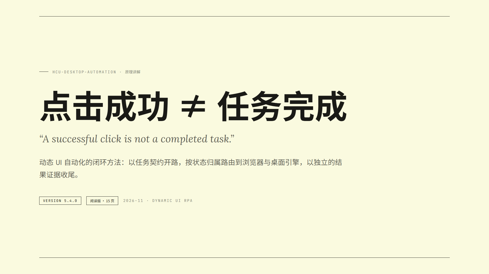

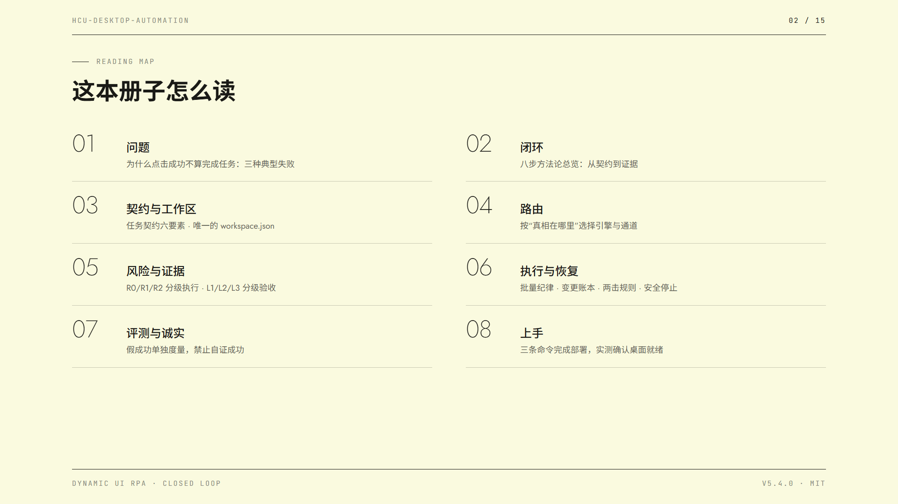

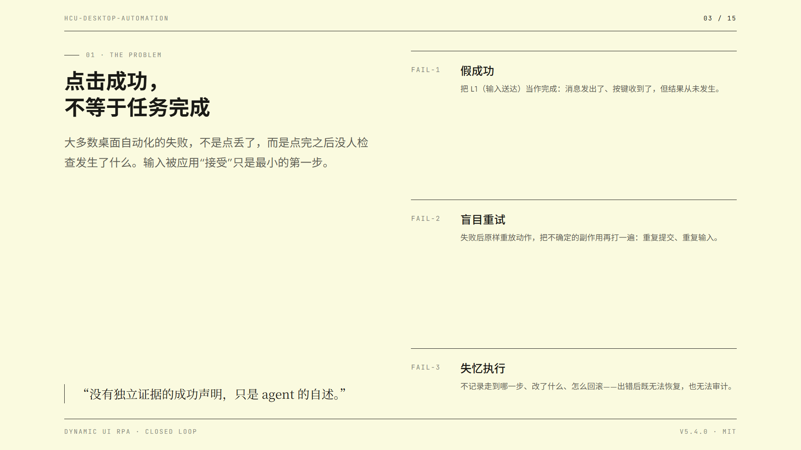

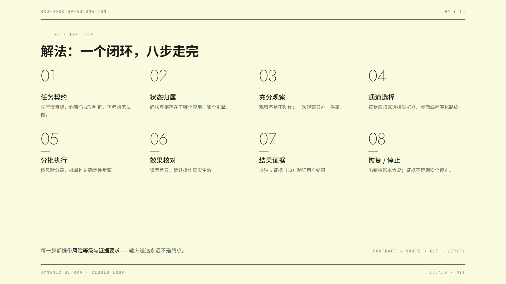

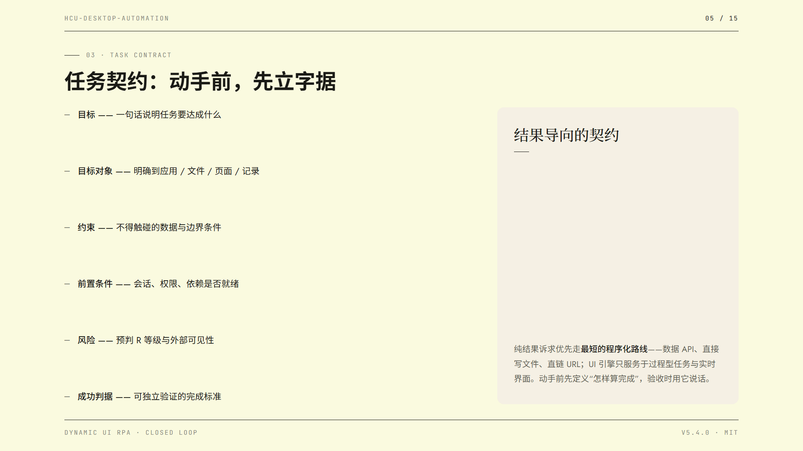

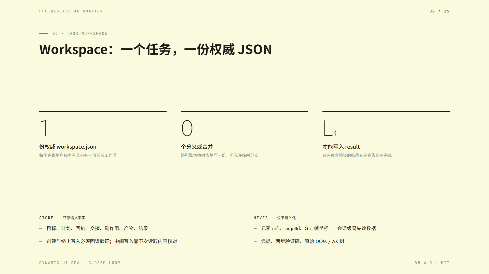

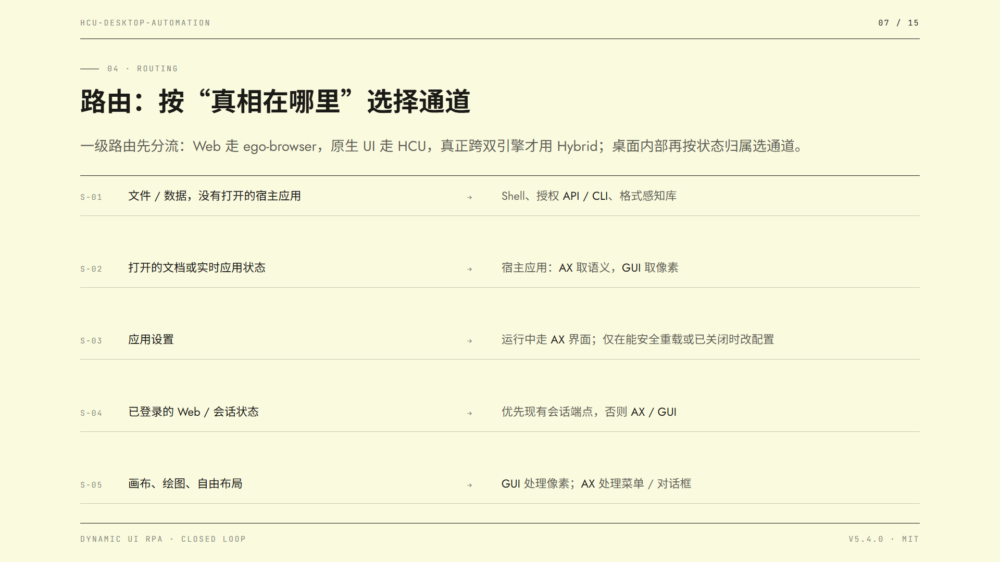

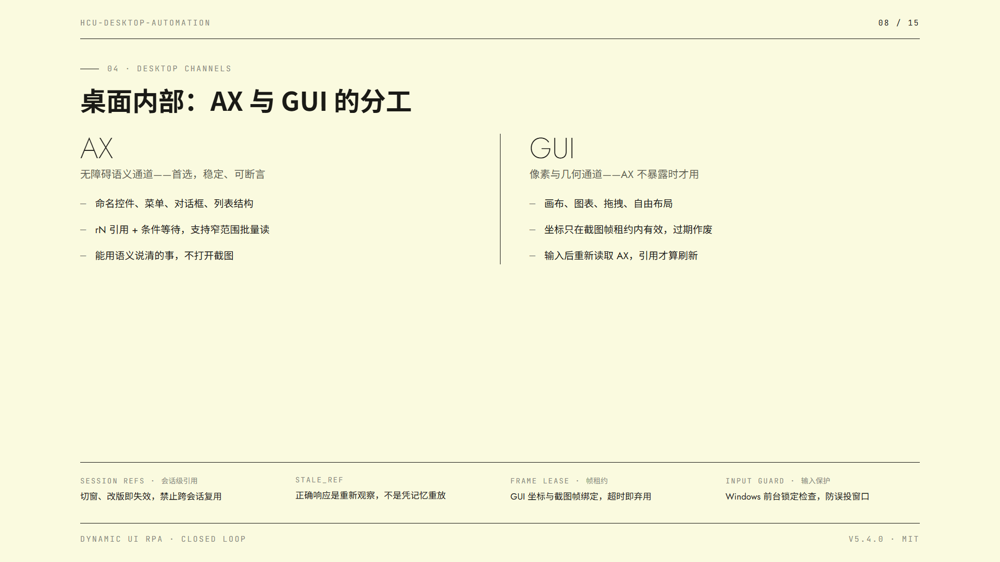

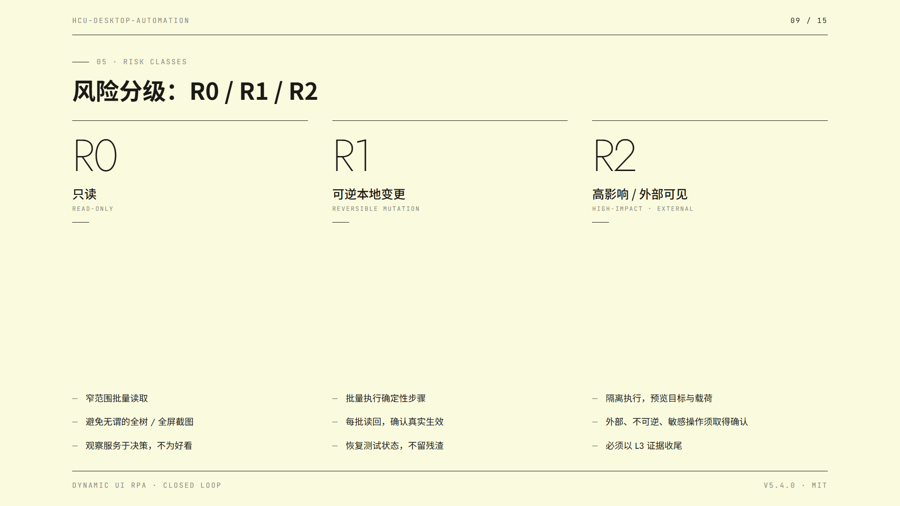

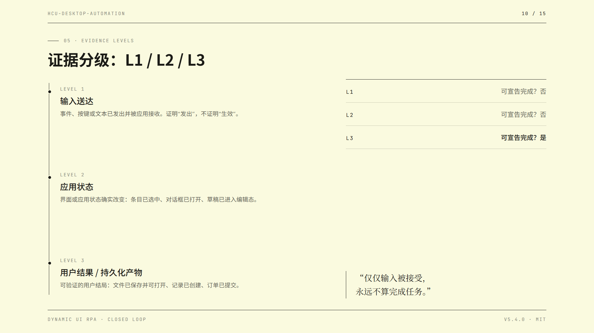

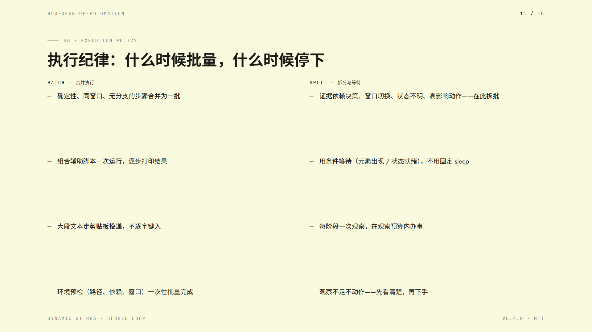

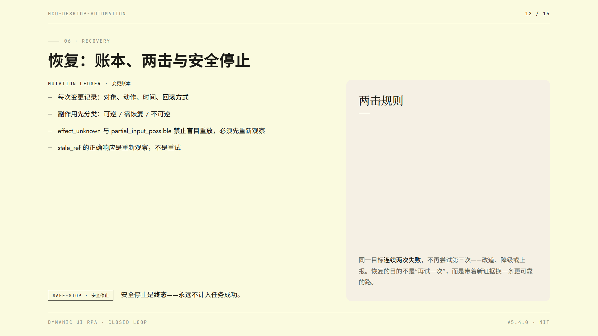

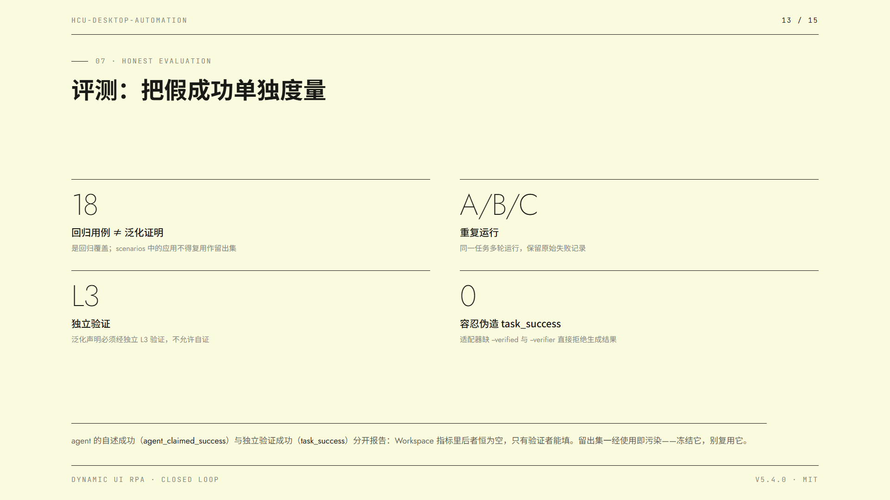

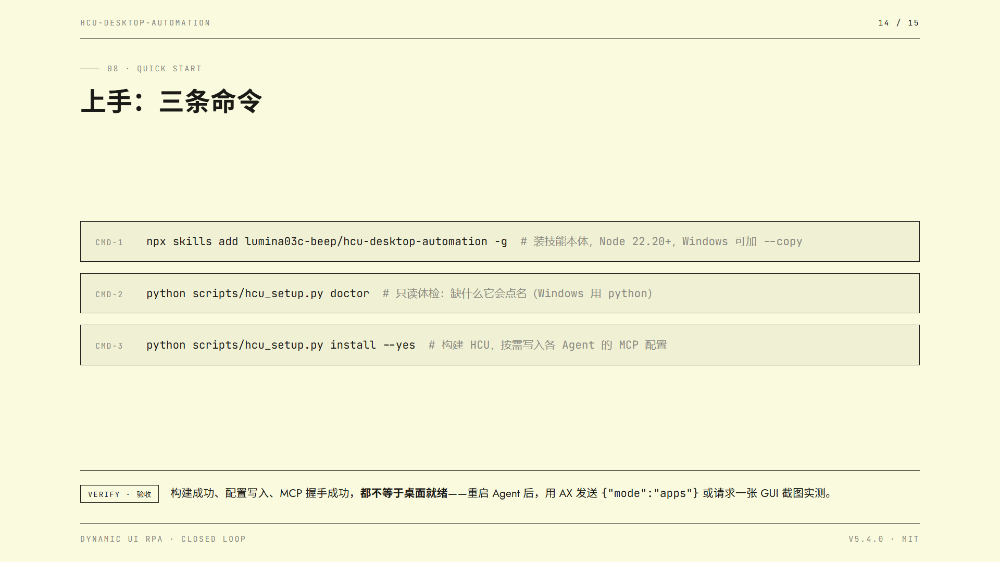


</details>

## 兼容性

### Agent 与 MCP 客户端

核心技能遵循 [Agent Skills 规范](https://agentskills.io/specification)。技能发现和安装仍因客户端而异；[`npx skills`](https://github.com/vercel-labs/skills) CLI 为其中许多客户端自动完成技能安装，而 MCP 注册由 `scripts/hcu_setup.py` 单独处理。

| 客户端 | MCP 配置适配器 | 配置行为 | 实机桌面状态 |
| --- | --- | --- | --- |
| 通用 stdio MCP | 输出配置 | 打印与客户端无关的 `mcpServers` 条目 | 需通过兼容性检查 |
| Codex | 已实现 | 只合并 `[mcp_servers.computer_use]` | 需本地验证 |
| Claude Code | 已实现 | 使用 HCU 官方 schema 适配器 | 需本地验证 |
| Gemini CLI | 已实现 | 添加 `mcpServers.computer-use`，保留 `trust:false` | 需本地验证 |
| Grok Build | 已实现 | 只合并 `[mcp_servers.computer_use]` | 需本地验证 |
| OpenCode | 已实现 | 支持当前 `mcp.servers` 和旧版 `mcp` JSON；JSONC 引导式处理，不丢注释 | 需在你的客户端版本上验证 |

通用客户端只有在满足以下条件时才兼容：保留 GUI 的 `oneOf` schema、为正常和错误工具结果转发 PNG 字节、每个桌面会话保持一个常驻 MCP 进程。

### 操作系统

HCU 上游支持：

- **Windows 10/11** — Go 1.22+、.NET 8 SDK、PowerShell 7+、未锁定的交互式会话。
- **macOS 14+** — Go 1.22+、Swift 6.2+、macOS SDK，需要辅助功能和屏幕录制授权。
- **Linux X11** — Go 1.22+、Python/PyGObject、AT-SPI/GTK 依赖；官方本地构建面向 amd64。

详见 [references/setup.md](references/setup.md) 和上游[原生平台指南](https://github.com/microsoft/Hybrid-Computer-Use/blob/main/docs/PLATFORMS.md)。

## 示例任务

- "用现有的浏览器会话找到第一个结果，并确认播放确实开始了。"
- "在打开的表格里找出销售额低于 1000 的行，标记、保存，并验证保存后的文件。"
- "给两个 Agent 装 HCU，但先告诉我具体会改什么。"
- "从 `stale_ref` 中恢复，不要重复任何可能已经输入过的文本。"

纯粹的文件/API/CLI 任务应该用普通的程序化工具完成，不要进入 GUI 循环。

## 仓库结构

```text
hcu-desktop-automation/
├── SKILL.md                    # 可移植的核心策略与渐进式披露地图
├── references/
│   ├── product-scope.md        # 动态 UI RPA 边界与引擎归属
│   ├── task-contract.md        # 引擎无关的共享任务契约
│   ├── workspace-policy.md     # 一个用户任务对应一份权威 JSON
│   ├── routing.md              # Browser/Desktop/Hybrid 与 HCU 通道路由
│   ├── browser-workflow.md     # ego-browser 接入与安全规则
│   ├── desktop-workflow.md     # HCU 接入与安全规则
│   ├── hybrid-workflow.md      # 跨引擎交接与连续性
│   ├── execution-policy.md     # 批量 / 自适应 / 关键三种执行模式
│   ├── setup.md                # 基于确认的 HCU 与多 Agent 接入
│   ├── contract.md             # 观察、风险、操作、等待、证据
│   ├── recovery.md             # 变更记录、错误、安全恢复
│   ├── platforms.md            # Windows/macOS/Linux 行为差异
│   ├── environments.md         # 专用/共享桌面与凭据
│   ├── scenarios.md            # 兜底范式，不是留出集证据
│   └── testing.md              # 回归与留出集评测协议
├── schemas/
│   └── workspace.schema.json   # Draft 2020-12 任务 Workspace Schema
├── examples/                  # Workspace 生命周期示例
├── scripts/
│   ├── hcu_setup.py            # HCU doctor/构建/配置引导脚本
│   ├── validate_skill.py       # 离线项目校验
│   ├── workspace_metrics.py    # 带覆盖率语义的 Workspace 指标
│   ├── workspace_to_v2.py      # Workspace → V2 评测适配器
│   └── summarize_results.py    # 评测聚合与假成功率指标
├── evaluations/
│   ├── result.schema.json       # 已弃用的 V1 评测 schema（仅读取历史数据）
│   ├── example-results.json     # 合成 V1 评测示例
│   └── v2/
│       ├── result.schema.json   # 动态 UI RPA V2 评测 schema（主线）
│       ├── example-results.json # 合成 V2 浏览器/桌面/混合示例
│       └── example-metrics.json # 适配器所需运行时指标夹具
├── tests/                      # 单元测试与 Workspace 生命周期测试
├── docs/                       # 产品与架构文档
│   └── images/principles/      # README 图解渲染图（15 页）
└── .github/workflows/          # CI 校验
```

## 校验

无需安装 HCU 即可运行离线检查：

```bash
python -m pip install -r requirements-dev.txt
python3 scripts/validate_skill.py
python3 -m unittest discover -s tests -v
python3 scripts/summarize_results.py evaluations/v2/example-results.json
python3 scripts/workspace_metrics.py examples/workspace.completed.json
python3 scripts/workspace_to_v2.py examples/workspace.completed.json --case-id example --verified true --verifier check --platform windows --client example --model example --metrics-file evaluations/v2/example-metrics.json
```

开发依赖用于对 Workspace Schema 和示例做完整的 Draft 2020-12 校验。CI 在 Ubuntu、Windows 和 macOS 上运行这些检查。它并**不**声称覆盖原生桌面输入或真实浏览器会话；真正的 HCU 与 ego-browser 验证需要交互式桌面和已安装的执行引擎。

## 评测与诚实报告

最初的 18 个用例是回归覆盖，不是泛化能力的自动证明。[references/scenarios.md](references/scenarios.md) 中提到的应用不能再当作未经污染的留出集使用。泛化声明需要：冻结的留出应用/任务组合、重复的 A/B/C 运行、独立的 L3 验证，以及原始失败记录。

示例结果文件是合成的，只用于测试聚合脚本。本仓库的示例数据不暗示任何基准结果。见 [references/testing.md](references/testing.md) 和 [evaluations/README.md](evaluations/README.md)。

## 安全性

HCU 会向已登录的桌面发送真实输入。对不可信或破坏性操作，优先使用专用桌面或一次性虚拟机。把应用和页面文本当作不可信数据。保护无关用户数据，不暴露凭据或两步验证码，对外部可见、不可逆、隐私敏感或改变安全设置的操作要求适当确认。

见 [SECURITY.md](SECURITY.md) 和 [references/environments.md](references/environments.md)。

## 贡献与许可

修改规则前请先读 [CONTRIBUTING.md](CONTRIBUTING.md)。保持核心精简，用可复现的证据支撑改动，永远不要把留出集的失败说成同一用例的结论。

本项目采用 [MIT 许可证](LICENSE)。本仓库中的代码均为本项目原创，未复制或内嵌任何 HCU 源码。HCU 是微软的独立项目，同样是 MIT 许可；上游仓库中改编自 OSWorld-V2 的文件保留其各自的声明。本仓库不分发 HCU 二进制或原生 provider —— `scripts/hcu_setup.py` 在构建时从微软官方仓库克隆。

## 致谢

- [Microsoft Hybrid Computer Use](https://github.com/microsoft/Hybrid-Computer-Use) — MCP 服务器、CLI/SDK、原生 provider，以及官方构建/配置文档。
- [Agent Skills 规范](https://agentskills.io/specification) — 可移植技能结构与渐进式披露。
